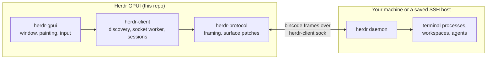

<p align="center">
  
</p>

<h1 align="center">Herdr GPUI</h1>

<p align="center">
  <a href="crates/herdr-gpui/README.md">GUI scope &amp; configuration</a> ·
  <a href="crates/herdr-gpui/PERFORMANCE.md">Performance report</a> ·
  <a href="AGENTS.md">Contributing</a>
</p>

A native Rust/GPUI client for macOS, Linux, and Windows, for a
[Herdr](https://herdr.dev/) daemon you installed yourself. It paints the daemon's terminal cells, split panes included, without
running another terminal emulator or wrapping the TUI.

> **Unaffiliated project.** Not affiliated with, endorsed by, or supported by
> Herdr or [herdr.dev](https://herdr.dev/).

This repository, [Noosphaira/noosphere-herdr-gpui](https://github.com/Noosphaira/noosphere-herdr-gpui),
is based on herdr-gpui by Fabien Penso (Apache-2.0) and is developed separately
from it.

## Gallery

<p align="center">
  
  <br>
  <sub><b>Workspaces, worktrees, and agents in one sidebar.</b> Each agent carries the daemon's status dot (idle, working, or waiting on you), and tabs and splits are painted natively from the daemon's cells.</sub>
</p>

<table>
  <tr>
    <td width="50%" valign="top">
      
      <br>
      <sub><b>Worktree popover.</b> Right-click a workspace or worktree for a new worktree, fan out, rename, Teleport, checkpoints, close, or delete the checkout.</sub>
    </td>
    <td width="50%" valign="top">
      
      <br>
      <sub><b><a href="crates/herdr-gpui/README.md#teleport">Teleport</a>.</b> Move a worktree to another host with its commits, uncommitted changes, tabs, splits, running programs, and agent sessions.</sub>
    </td>
  </tr>
  <tr>
    <td colspan="2">
      
      <br>
      <sub><b><a href="crates/herdr-gpui/README.md#reviewing-an-agents-changes">Review an agent's changes</a>.</b> Open <b>Review changes…</b> from the title bar's Git menu, click any line to leave a note like a pull request comment, then <b>Send to agent</b>.</sub>
    </td>
  </tr>
  <tr>
    <td colspan="2">
      
      <br>
      <sub><b>Side-by-side diffs and a collapsed sidebar.</b> Switch the review to side by side, and fold the sidebar to a rail that keeps every workspace and agent one click away.</sub>
    </td>
  </tr>
  <tr>
    <td colspan="2">
      
      <br>
      <sub><b><a href="crates/herdr-gpui/README.md#annotating-a-page">Browser tabs with annotations</a>.</b> An agent opens its page with <code>herdr-gpui browser open</code>; you pick elements or regions, write notes, and send them back to that agent. Listening ports such as <code>:4173</code> appear under their workspace.</sub>
    </td>
  </tr>
  <tr>
    <td colspan="2">
      
      <br>
      <sub><b>Sidebar layouts.</b> Pick a density or a design of its own from <b>View &gt; Layout</b> or Settings; the choice applies live.</sub>
    </td>
  </tr>
  <tr>
    <td width="50%" valign="top">
      
      <br>
      <sub><b><a href="docs/usage-providers.md">Plan usage</a>.</b> The status bar shows the signed-in AI services closest to their limits; click one for the details.</sub>
    </td>
    <td width="50%" valign="top">
      
      <br>
      <sub><b>CPU and memory per host.</b> The status bar follows the selected host, and with several hosts each sidebar host row shows its own, read over SSH for remote machines.</sub>
      <br><br>
      
      <br>
      <sub><b>Native settings.</b> A live preview and a searchable grid of every built-in and Ghostty theme, plus fonts, indicators, sounds, and notifications.</sub>
    </td>
  </tr>
  <tr>
    <td colspan="2">
      
      <br>
      <sub><b>Light or dark, or both.</b> Any theme, or a light and dark pair that follows the system appearance; status colours keep their contrast on either.</sub>
    </td>
  </tr>
</table>

Also included: saved SSH hosts with [file copies](crates/herdr-gpui/README.md#ssh-file-copies),
[inline images](crates/herdr-gpui/README.md#images),
[clickable links](crates/herdr-gpui/README.md#terminal-links),
[file drops](crates/herdr-gpui/README.md#file-drops),
[editor groups](crates/herdr-gpui/README.md#editor-groups), and
[system notifications](crates/herdr-gpui/README.md#system-notifications),
[sounds](crates/herdr-gpui/README.md#notification-sounds), and a
[Dock badge](crates/herdr-gpui/README.md#macos-dock-badge) when an agent needs you.

## Install

There are no prebuilt packages and no in-app updater. Build the app from source
and rebuild it to update.

### From source

Install Rust/rustup and, on macOS, the Xcode command-line tools. The repository
pins Rust 1.96.1 and GPUI 0.3.6 (the `gpui-pre` snapshot crate); the Rust version
is declared in `rust-toolchain.toml` and mirrored in `mise.toml`, so `mise install`
also provisions it.

```sh
git clone https://github.com/Noosphaira/noosphere-herdr-gpui.git
cd noosphere-herdr-gpui
just run
```

`just run` uses the optimized release build with the QA menu enabled;
`just run-debug` is notably slower with a dense terminal on screen.
On macOS both build a local bundle identified as `so.pen.herdr-gpui.dev`.
Without `just`: `cargo run --locked --release -p herdr-gpui --features qa-menu`.

To install a Linux build for the current user, with its launcher entry and
icon, run `bash contrib/local-agents/install-gui.sh`. With Nix, the repository's
flake builds the app on x86_64 and ARM64 Linux with the toolchain pinned in
`rust-toolchain.toml`; from the checkout:

```sh
nix run .
```

Install the Herdr daemon separately. The app starts an already-installed local
`herdr server` when the target session is absent, but never installs or upgrades
a daemon. Explicitly confirming session deletion stops that named session first;
closing or removing the GUI leaves daemon sessions and shared Herdr
configuration intact.

### Linux Builds

On Ubuntu 24.04 (x86_64 or ARM64), run `bash scripts/install-linux-deps.sh`
before building. This installs GPUI's X11/Wayland/font development dependencies
and `libasound2-dev` for Rodio/CPAL native audio. `just lint-linux` and `just
stress-linux` use the same script in their containers. Linux binaries require
the system ALSA shared library (`libasound2t64` on Ubuntu 24.04), a configured
default audio device, and Vulkan for rendering. Audio normally routes through
the desktop's ALSA plugin configuration; no CLI audio player is required. Custom
notification sounds are MP3 only. See [notification
sounds](crates/herdr-gpui/README.md#notification-sounds).

### Windows

Windows is experimental, not a supported platform: `just lint-windows`
cross-checks the code for Windows, but no native window, renderer, or live
daemon has been exercised. Local
connections use the named pipe the Windows daemon binds, and configuration and
state follow its `%APPDATA%` / `%LOCALAPPDATA%` layout. A Herdr daemon inside a
WSL distribution can be added as a device from **Add Device…**; see
[WSL distributions](crates/herdr-gpui/README.md#wsl-distributions). Saved SSH
hosts, saved GitHub credentials, and the avatar disk cache are
unavailable and report that plainly; see
[the GUI README](crates/herdr-gpui/README.md#windows).

Build it from source with `cargo build --locked --release -p herdr-gpui`. The
executable is console-subsystem, so launching it from Explorer also opens a
console window.

## How it connects



The daemon owns the terminals and all session state. The GUI attaches to the
binary **client** socket, renders the surfaces it is sent, and sends semantic
input back. Closing or detaching the GUI leaves the daemon and its terminals
running.

[Browser tabs](crates/herdr-gpui/README.md#browser-tabs) are the exception:
Herdr has no browser panes, so web pages shown beside a workspace's terminals
belong to the GUI alone. Agents in your panes open them with
`herdr-gpui browser open URL`, which reaches the running app over a local
socket of its own.

## Audio Test

The QA menu is excluded from default Cargo builds.
`just run` enables it automatically; with Cargo, use
`cargo run --locked --release -p herdr-gpui --features qa-menu`.
To manually test native audio in that build, choose **QA > Play Sound**. It plays the built-in
Done sound on the background Rodio worker, even without a daemon or active pane
and even with notifications muted. `HERDR_DISABLE_SOUND` and `NEXTEST` still
suppress playback. See [notification sounds](crates/herdr-gpui/README.md#notification-sounds)
for queue limits and playback details.

## Performance

`just test-perf` opens a daemon-free native fixture with a dense 160x50 terminal,
40 workspaces, and 40 agents. It dispatches real window-local mouse/scroll events
and measures cold frames, warm hover, and both sidebar lists' scrolling. It also
asserts that unchanged terminal cells need zero new text-shaping calls, validates
batched background counts, and compares cached glyphs with freshly shaped ones.

On the development M4 Max, caching and background batching reduced release hover
p95 from about 51 ms to 12 ms, and scrolling from 56 ms to 14 ms. The benchmark
measures CPU event-to-scene construction, not GPU completion or pointer-to-screen
latency. Use `just test-perf 50` to set a different calibrated budget; native tests
remain opt-in rather than imposing machine-dependent timings.

See [PERFORMANCE.md](crates/herdr-gpui/PERFORMANCE.md) for the before/after results,
reference mode, workload, deterministic checks, and remaining limitations.

## License

Apache-2.0. See [LICENSE](LICENSE) and [NOTICE](NOTICE), plus the
[upstream protocol attribution](crates/herdr-protocol/NOTICE.md) for the
vendored parts of `herdr-protocol`. Based on herdr-gpui by Fabien Penso,
licensed under Apache-2.0; the original copyright notice is kept in
[NOTICE](NOTICE).
